<div align="center">

# dotfiles

Hyprland on Arch, with **astralis**: a desktop shell written in
[Quickshell](https://quickshell.org). Every colour comes from the wallpaper.


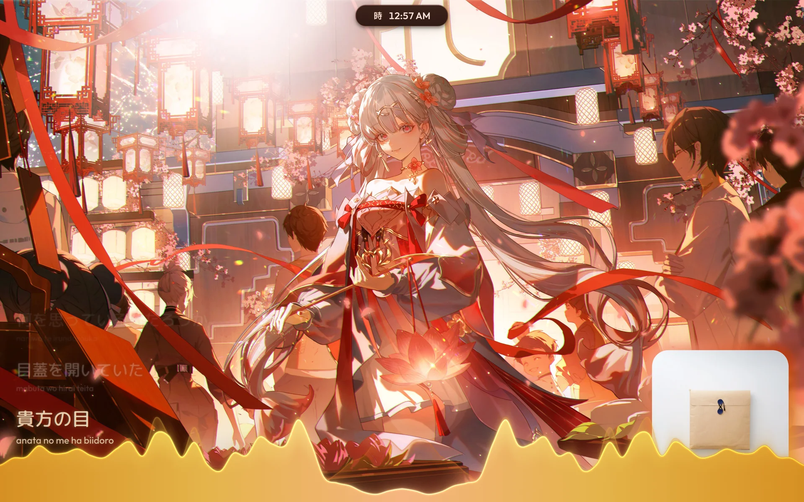

</div>

The shell, Hyprland's borders, the terminals, Neovim, GTK and Qt apps, cava,
btop, fzf, Spotify and Firefox/Zen all take their colours from the wallpaper.

There's also **quartz**, a lighter second shell in
[its own repo](https://github.com/immortal-forest/quartz).

## astralis

One pill at the top of the screen holds the workspaces, the clock, what's
playing, the tray and the status icons. Every surface grows out of it and folds
back into it.

<table>
  <tr>
    <td width="50%">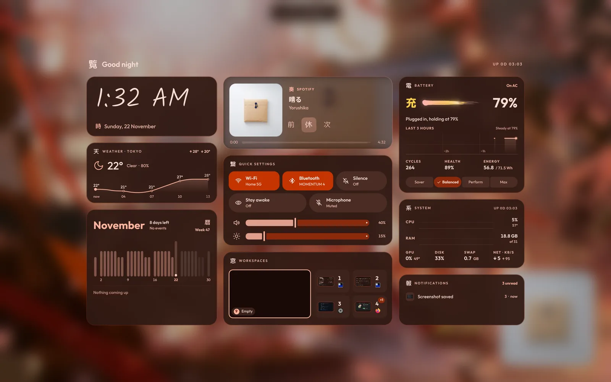<br><sub>Overview: clock, weather, now playing, quick settings, battery and system</sub></td>
    <td width="50%">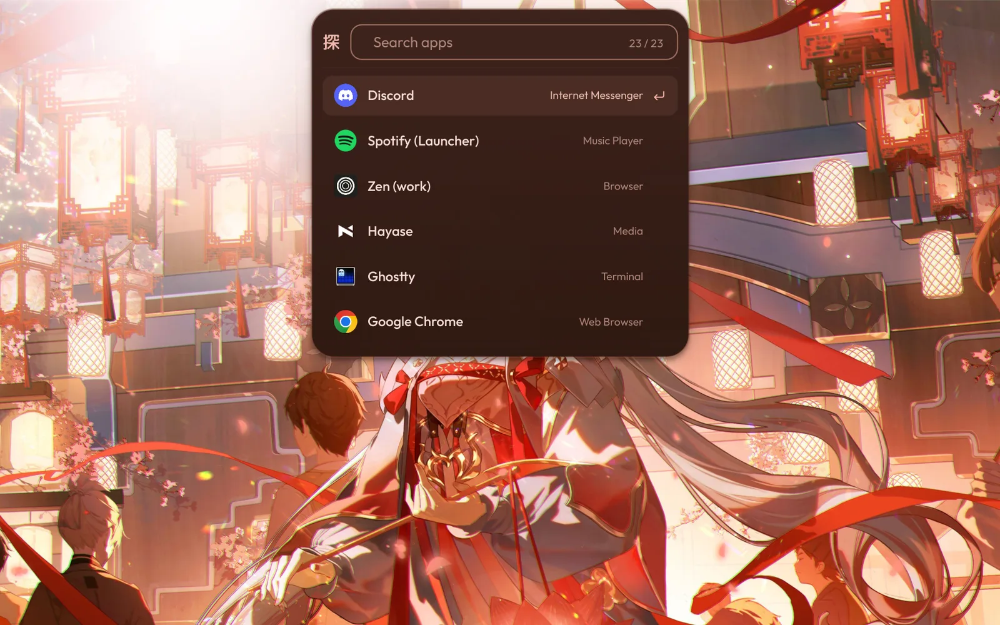<br><sub>Launcher</sub></td>
  </tr>
  <tr>
    <td>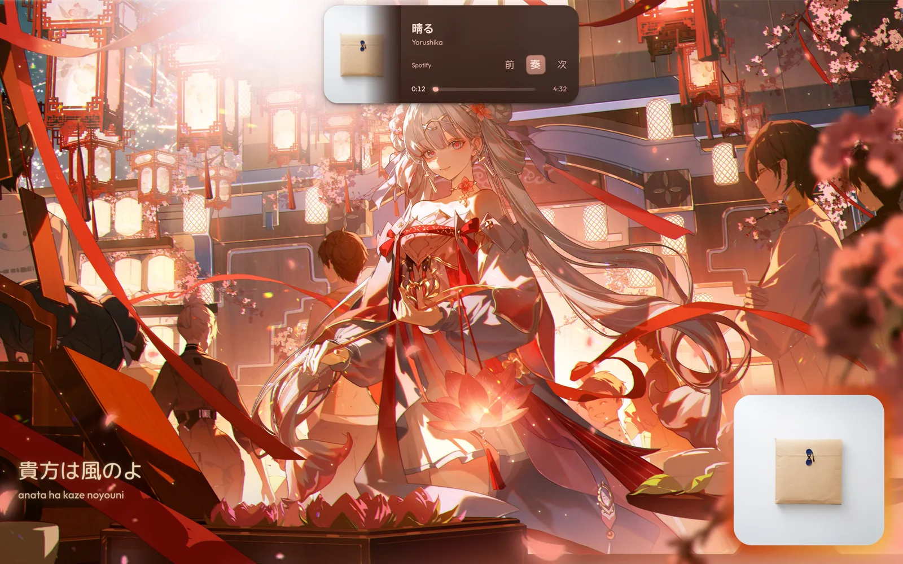<br><sub>Media, with synced lyrics and romaji on the desktop</sub></td>
    <td>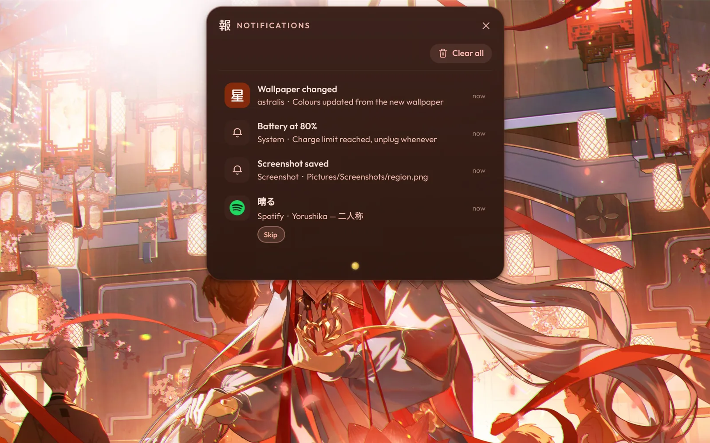<br><sub>Notifications</sub></td>
  </tr>
  <tr>
    <td>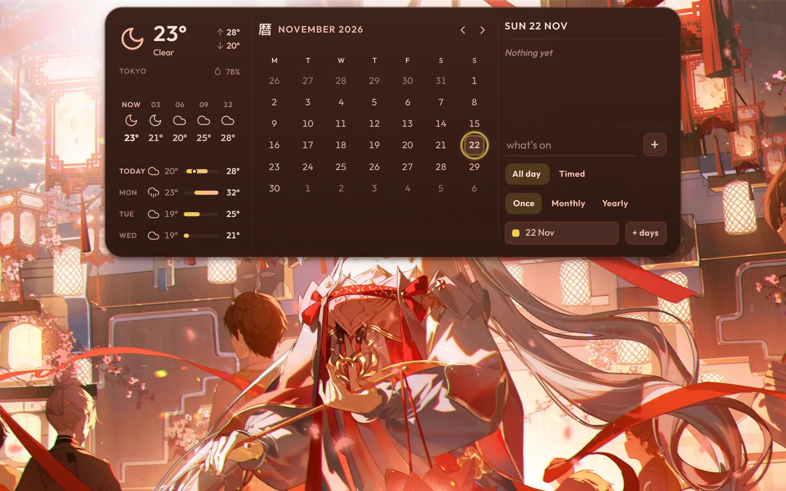<br><sub>Calendar with the week's weather</sub></td>
    <td>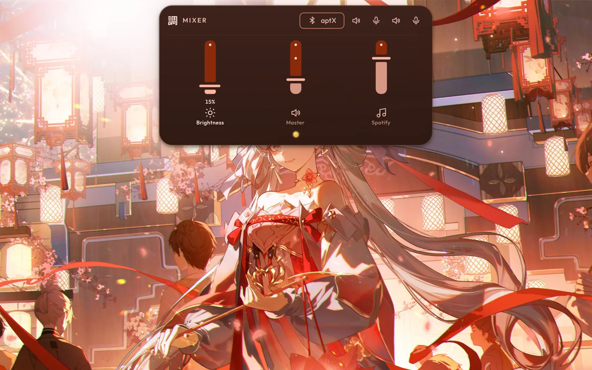<br><sub>Mixer: brightness, output and per-app volume</sub></td>
  </tr>
  <tr>
    <td>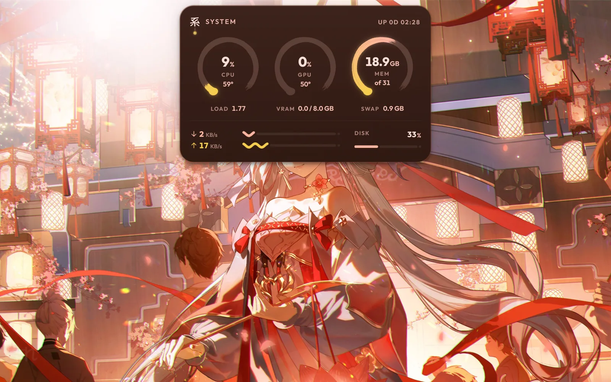<br><sub>System monitor</sub></td>
    <td>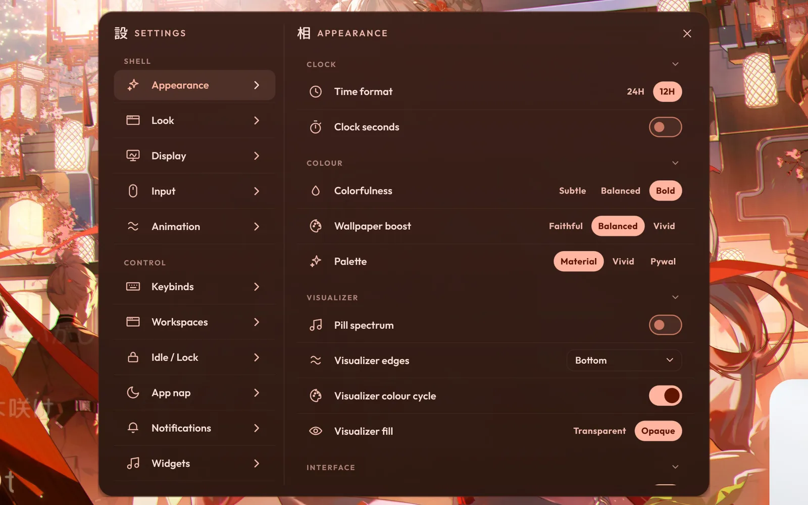<br><sub>Settings</sub></td>
  </tr>
  <tr>
    <td>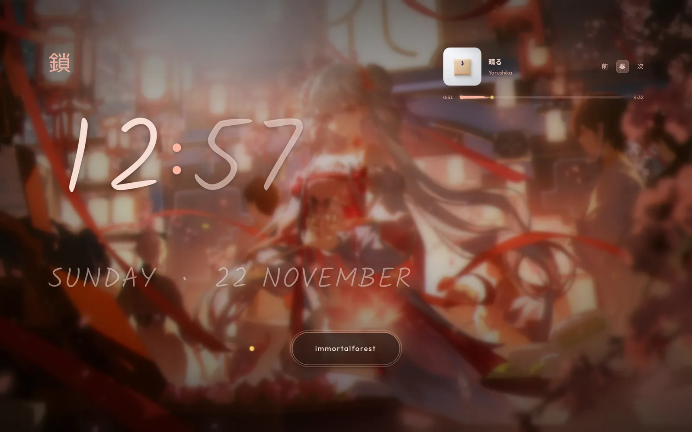<br><sub>Lock screen</sub></td>
    <td>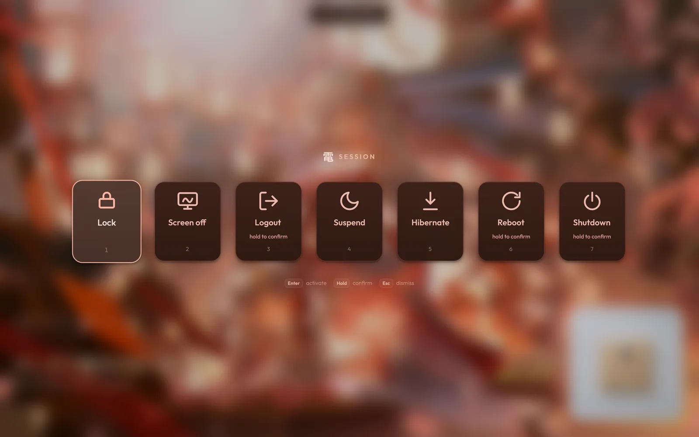<br><sub>Power menu</sub></td>
  </tr>
</table>

### In the pill

| | What it does |
|:---|:---|
| **Launcher** | Fuzzy app search. Ctrl + Enter opens an app once on the NVIDIA GPU, Ctrl + G pins it there |
| **Clipboard** | History with image previews |
| **Media** | Now playing, with a seek bar and controls |
| **Calendar** | The month, with the week's weather |
| **Mixer** | Brightness, output device and per-app volume |
| **Wi-Fi and Bluetooth** | Connect, pair and forget. Each saved network has its own auto-connect, metered and password settings |
| **Notifications** | History, Do Not Disturb with quiet hours, and a rule for every installed app |
| **System monitor** | CPU, GPU and memory with temperatures, network and disk |
| **Screen recorder** | The whole screen or a region |
| **Settings** | Appearance, input, keybinds, idle and lock, notifications, widgets and more |
| **Indicators** | Volume, brightness and the mic show in the pill when you press their keys |

### On the desktop

| | What it does |
|:---|:---|
| **Overview** | Clock, weather with a 12-hour temperature curve, now playing, quick settings, battery, system load and the power profile |
| **Lyrics** | Synced lyrics next to the cover art, from NetEase, LRCLIB and Kugou. Word-timed where they exist, with romaji for Japanese lines |
| **Depth&nbsp;clock** | A clock that sits behind the wallpaper's subject. A depth model (Depth Anything V2 Small) cuts out the foreground; it downloads about 140 MB the first time you turn it on |
| **Visualizer** | An audio wave along the screen edges |
| **Retroact&nbsp;Rain** | Rain that falls, hangs in mid-air and rises again, refracting the wallpaper. It also plays when you pick a new wallpaper |
| **App nap** | Hides the focused app, freezes it and pushes its memory to swap until you bring it back |
| **Lock&nbsp;screen** | Clock, now playing and the password field |
| **Power&nbsp;menu** | Lock, screen off, log out, suspend, hibernate, reboot, shut down |

Every shortcut is in [Keys](#keys).

### Colours and wallpapers

Material 3 colours, made from the wallpaper by
[matugen](https://github.com/InioX/matugen). Settings › Appearance can switch
the terminals and apps to a base16 palette instead. Wallpapers are drawn and
picked by [skwd-wall](https://github.com/liixini/skwd-wall).

## What's in here

Every folder is a [GNU stow](https://www.gnu.org/software/stow/) package that
links into `$HOME`:

| Package | Links to | |
|---|---|---|
| `hypr` | `~/.config/hypr` | Hyprland, Lua config split up in `hypr.d/`, and hypridle |
| `quickshell` | `~/.config/quickshell` | astralis |
| `matugen` | `~/.config/matugen` | the colour templates for every app above |
| `skwd` | `~/.config/skwd-wall-v2` | wallpaper picker settings |
| `scripts` | `~/.local/bin` | `setwall`, `rice`, `appnap`, `wallgrab` (one gallery for several wallpaper sites), `wall-tags`, `astralis` (the wordmark, live in a terminal) |
| `ghostty`, `kitty` | `~/.config/…` | terminals |
| `zsh` | `~/.zshrc` | zinit, fzf-tab, autosuggestions, starship |
| `starship` | `~/.config/starship` | four prompt layouts |
| `tmux` | `~/.config/tmux` | tpm, vim-tmux-navigator, catppuccin |
| `nvim` | `~/.config/nvim` | NvChad, themed by matugen |
| `icons` | `~/.local/share/icons` | the Google.Violet cursor |
| `git` | `~/.gitconfig` | my name and signing key, so skip it if you're not me |

`system/` isn't linked. It holds the PKGBUILDs for our own builds (see
[Built packages](#built-packages)) and a udev rule (see [Extras](#extras)).

## Install

Needs Arch Linux and a user with sudo.

```sh
git clone https://github.com/immortal-forest/dotfiles ~/dotfiles
cd ~/dotfiles
./setup.sh
```

`setup.sh`:

1. installs whatever is missing from the Arch repos and the AUR (it builds
   yay if there's no AUR helper). It never upgrades or replaces anything that
   is already installed.
2. installs our own builds from the
   [packages release](https://github.com/immortal-forest/dotfiles/releases/tag/packages):
   the patched skwd-wall and Obel Mono Lig. Each download has to match the
   sha256 pinned in `setup.sh`.
3. downloads Outfit, the shell's UI font
4. links every package. Anything in the way is moved to
   `~/.dotfiles-backup/<time>/`. An existing `~/.gitconfig` of yours is kept.
5. clones the tmux plugin manager and points starship at a prompt
6. checks the GPU settings against your machine

On a fresh system that's about 1.2 GB of packages. It's safe to run again after
a `git pull`.

| Flag | |
|---|---|
| `--dry-run` | print what it would do, change nothing |
| `--no-packages` | skip pacman, the AUR and our builds |
| `--no-fonts` | skip the Outfit download |
| `--skip git,kitty` | don't link these packages |
| `--extras` | also install the udev rule |
| `--yes` | don't ask before installing packages |

### Before you log in

Two files are set up for my laptop (AMD iGPU and NVIDIA dGPU):

- `hypr/.config/hypr/hypr.d/graphics.lua`: `AQ_DRM_DEVICES` picks the GPU that
  renders the desktop (`card2`, the AMD one, here), and there are NVIDIA and
  VA-API variables. `setup.sh` warns when they don't fit your machine. Fix them
  or delete the lines.
- `hypr/.config/hypr/hypr.d/monitor.lua`: my 1440p 180 Hz screen on `DP-3`.
  Every other screen gets its preferred mode.

Then log into Hyprland and astralis starts with it. Press Super+C and pick a
wallpaper: the shell and every themed app recolour.

### By hand

- **btop**: pick the `astralis` colour theme (Esc → Options → Color theme).
- **Spotify**: put the [Sleek](https://github.com/spicetify/spicetify-themes/tree/master/Sleek)
  theme in `~/.config/spicetify/Themes/Sleek`, then run
  `spicetify config current_theme Sleek color_scheme Astralis inject_css 1 replace_colors 1`
  and `spicetify backup apply`. matugen rewrites the colours on every wallpaper
  change. Stay on `spicetify-bin`, because the `-git` build leaves Spotify blank.
- **Firefox and Zen**: install the [Pywalfox](https://addons.mozilla.org/firefox/addon/pywalfox/)
  add-on in each, then run `pywalfox install`.
- **Login shell**: `chsh -s /usr/bin/zsh`

### Extras

`./setup.sh --extras` also installs a udev rule (needs sudo) that lets the
`wheel` group change the ACPI power profile, so the overview can switch it
without root.

## Built packages

Two things here aren't in the repos or the AUR, so they're built from
`system/` and attached to the
[packages release](https://github.com/immortal-forest/dotfiles/releases/tag/packages):

- **skwd-wall-v2**, patched: the picker only offers your wallpaper folders,
  with no "All wallpapers" entry. It replaces `skwd-wall-v2-bin` and needs
  `skwd-deck-bin` and `skwd-paper-bin` of the same version.
- **ttf-obel-mono-lig**: [Obel Mono](https://typographic.systems) with
  programming ligatures (`->` `=>` `!=` `::` and more), made by
  `system/obel-mono-lig/build.py`. Ghostty uses it.

Both are built on Arch by GitHub Actions (`.github/workflows/packages.yml`),
and `setup.sh` checks every download against the release's `SHA256SUMS`.

## Keys

| Key | |
|---|---|
| Super + Space | launcher |
| Super + V | clipboard |
| Super + N | notifications |
| Super + A | audio mixer |
| Super + K | Wi-Fi and Bluetooth |
| Super + D | calendar |
| Super + M | media |
| Super + O | overview |
| Super + Shift + S | system monitor |
| Super + , | settings |
| Super + C, Super + Shift + C | pick a wallpaper, random wallpaper |
| Super + B | visualizer |
| Super + Shift + W | Retroact Rain |
| Super + R | recorder. Alt + R records the screen, Ctrl + R a region |
| Super + P | screenshot a region. Ctrl + P freezes the screen first, Alt + P takes the whole monitor |
| Super + Ctrl + M | nap the focused app. Super + Shift + M shows the hidden ones |
| Super + L | lock |
| Super + Esc | power menu |
| Super + Shift + R | restart the shell |
| Super + T, Super + F | terminal (Ghostty), browser (Zen) |
| Super + Q | close the window |

The rest are in `hypr/.config/hypr/hypr.d/keybinds.lua`.

## Scripting

astralis takes commands over Quickshell's IPC:

```sh
qs -c astralis ipc show                 # every target and what it takes
qs -c astralis ipc call pill launcher ""
qs -c astralis ipc call dashboard toggle
qs -c astralis ipc call rain toggle
qs -c astralis ipc call recorder region
setwall ~/wallpapers/some.jpg           # recolour everything from an image
```

## Updating

```sh
cd ~/dotfiles && git pull && ./setup.sh
```

Quickshell reloads astralis as soon as one of its files changes.

## Credits

[Quickshell](https://quickshell.org), [Hyprland](https://hyprland.org),
[matugen](https://github.com/InioX/matugen),
[skwd-wall](https://github.com/liixini/skwd-wall),
[Obel Mono](https://typographic.systems),
[Outfit](https://fonts.google.com/specimen/Outfit),
[Depth Anything V2](https://github.com/DepthAnything/Depth-Anything-V2),
lyrics from [LRCLIB](https://lrclib.net), NetEase and Kugou, and weather from
[Open-Meteo](https://open-meteo.com) and MET Norway.
